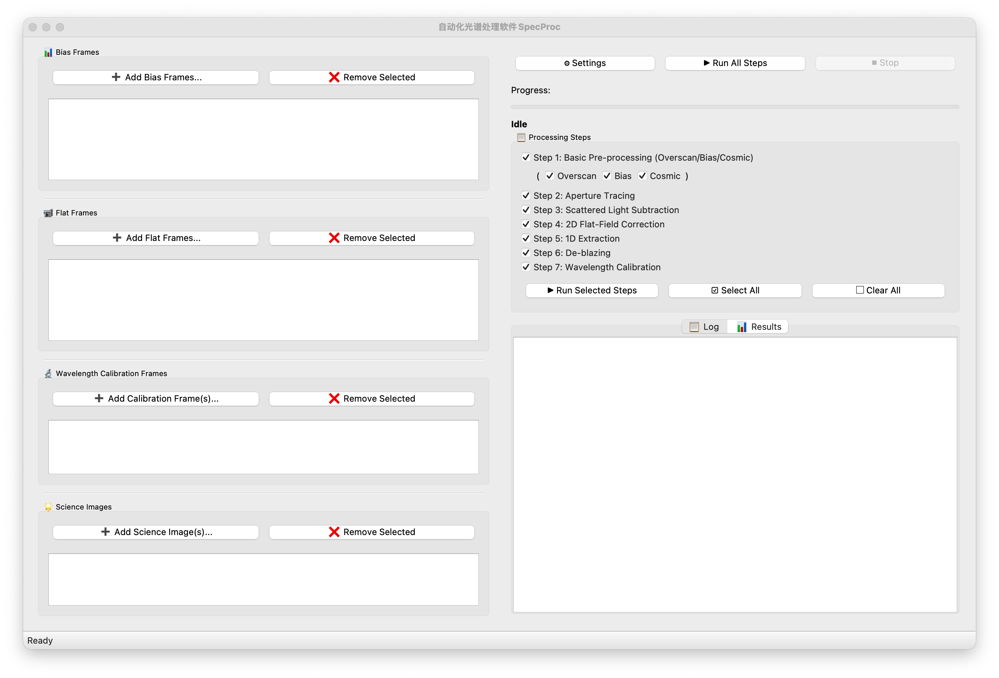

# SpecProc: PyQt GUI for Spectrograph Data Reduction

**English** | [简体中文](README_CN.md)



A complete PyQt-based graphical interface for reducing slit/chelle spectrograph FITS data.

## Table of Contents

- [Quick Start](#quick-start)
- [Features](#features)
- [Installation](#installation)
- [Working Directory Setup](#working-directory-setup)
- [Configuration](#configuration)
- [Processing Pipeline](#processing-pipeline)
- [Usage](#usage)
- [Calibration Data](#calibration-data)
- [Troubleshooting](#troubleshooting)
- [Documentation](#documentation)

## Quick Start

Install SpecProc with `pip install specproc`, then work from a directory
outside the source tree. Put your bias, flat, calibration-lamp, and science
FITS files in a data directory.

### Command line

```bash
mkdir -p ~/specproc-work
cd ~/specproc-work
specproc --profile LJ24_hrs /path/to/LJ_20241222
```

Replace `LJ24_hrs` with your telescope/instrument profile: `XL216_hrs`
(Xinglong 2.16 m HRS), `NS12_hrs` (Nanshan 1.2 m), or `MSTG193_slit`
(Muztagh-Ata 1.93 m slit). SpecProc classifies the input frames and runs the
pipeline; results and diagnostic plots are saved under `output/` by default.
Check the classification and processing messages in the log.

An existing working configuration may be reused rather than replaced by the
packaged defaults. Review any configuration-difference warning, or specify
your own configuration explicitly with
`specproc --config /path/to/config.cfg /path/to/data`. Run `specproc --help`
for more options.

### Graphical interface

```bash
specproc --mode gui
```

1. Open **Settings** → **Data & Instruments**. Under **Configuration File**,
   select your telescope/instrument profile, or use **Browse...** to load a
   configuration file. Check the output path and click **Save**.
2. Add the bias, flat, calibration-lamp, and science images using the
   corresponding buttons.
3. Click **Run All Steps**. Monitor the log and find the results in the
   configured output directory.

For more detail, see [Installation](#installation), [Working Directory
Setup](#working-directory-setup), and [Usage](#usage).

## Features

### Complete Reduction Pipeline

**8-stage automated spectral reduction**:

1. **Basic Pre-processing** - Overscan, bias subtraction, and cosmic ray correction
2. **Apertures Tracing** - Master flat generation and echelle aperture tracing
3. **Scattered Light Subtraction** - Inter-aperture background modeling and removal (astropy convolution or spline)
4. **2D Flat-Field Correction** - 2D pixel flat correction
5. **1D Spectrum Extraction** - optimal extraction for each aperture
6. **De-blazing** - Blaze function correction
7. **Wavelength Calibration** - Wavelength calibration applied to the optimal de-blazed 1D spectra
8. **Order Stitching** - Merge overlapping neighboring orders into a continuous 1D spectrum

### Interactive GUI

PyQt5-based user interface with:
- File management for bias, flat, and science frames
- Real-time progress tracking
- Processing logs and diagnostics
- One-click pipeline execution or step-by-step processing

### Key Features

- **Configuration-Driven**: INI-format configuration files for easy parameter adjustment
- **Generic Spectrograph Support**: Configurable for different echelle spectrographs
- **Flexible Output**: Control which intermediate results to save
- **Command Line Interface**: Alternative to GUI for batch processing

## Installation

Choose one of the following installation methods:

### Method 1: Using pip

Install SpecProc directly from PyPI.

```bash
# Install SpecProc
pip install specproc

# Launch application
specproc
```

**Notes:**
- Requires Python 3.7+
- Dependencies will be automatically installed from PyPI
- Installation is permanent; uninstall with `pip uninstall specproc`

### Method 2: Using conda

conda is a good fit when you want an isolated environment. SpecProc is **not published on conda-forge**, so the recipe is: create the conda environment, then `pip install` the package into it.

#### Option 2.1: Install in existing conda environment

```bash
# Activate your conda environment
conda activate your_environment

# Install SpecProc with pip
pip install specproc

# Launch application
specproc
```

#### Option 2.2: Create new conda environment

```bash
# Create new conda environment for SpecProc
conda create -n specproc python=3.11
conda activate specproc

# Scientific/GUI dependencies from conda, SpecProc itself from pip
conda install -c conda-forge numpy scipy astropy matplotlib pyqt -y
pip install specproc

# Launch application
specproc
```

**Notes:**
- Recommended for users who want an isolated environment
- Core dependencies are managed by conda; SpecProc itself is installed with pip
- Python 3.7-3.11 are supported

### Method 3: Installing from Source

Run the installation script to install SpecProc and all dependencies from local source.

```bash
# Navigate to SpecProc directory
cd /path/to/SpecProc

# Make the script executable (if needed)
chmod +x install.sh

# Run installation script
./install.sh

# Launch application
specproc
```

**Notes:**
- Installation script handles all dependencies automatically
- Detects available package manager (pip or conda)
- Installs SpecProc to your system
- Use this method for automated setup from local source

## Working Directory Setup

**Important**: SpecProc should be run in your working directory, NOT in the source code directory.

### Correct Workflow

```bash
# 1. Create your working directory (e.g., for an observation project)
mkdir -p /myworkspace
cd /myworkspace

# 2. Create subdirectories for data processing
mkdir -p 20241102_hrs output

# 3. Copy/move FITS data files to 20241102_hrs directory
cp /somewhere/bias_*.fits ./20241102_hrs/
cp /somewhere/flat_*.fits ./20241102_hrs/
cp /somewhere/thar_*.fits ./20241102_hrs/
cp /somewhere/science_*.fits ./20241102_hrs/

# 4. Run SpecProc with the appropriate telescope profile
specproc --profile XL216_hrs ./20241102_hrs
```

### Directory Structure

**Working directory** (where you process data):
```
/myworkspace/                  # Your working directory
├── 20241102_hrs/              # Input FITS files
│   ├── bias_*.fits
│   ├── flat_*.fits
│   ├── thar_*.fits      # ThAr lamp spectrum
│   └── science_*.fits   # Science images
├── output/                    # Processing results (auto-created)
│   ├── step1_basic/            # Step 1: Basic pre-processing
│   │   ├── overscan_corrected/ # Overscan-corrected images and diagnostic plots
│   │   ├── bias_subtracted/    # Master bias and bias-corrected images
│   │   └── cosmic_corrected/   # Cosmic ray corrected science images (if enabled)
│   ├── step2_trace/            # Step 2: Master flat field, blaze profiles, and diagnostic plots
│   ├── step3_scatterlight/     # Step 3: Background model and diagnostic plots
│   ├── step5_extraction/       # Step 5: Extracted 1D spectra and diagnostic plots
│   ├── step6_deblazing/        # Step 6: De-blazed spectra and diagnostic plots (if saved)
│   └── step7_wavelength/       # Step 7: Final wavelength calibrated 1D spectra and plots
│   └── step8_stitching/        # Step 8: Final stitched continuous 1D spectra and plots
├── specproc.cfg              # User config file (optional)
└── ...
```

**Note**:
- ❌ Do NOT run `specproc` in SpecProc source directory (`/path/to/SpecProc`)
- ✅ Run `specproc` in your working directory
- ✅ `output` will be created in your working directory

## Configuration

### Config File Types

#### Default Configuration

**Location**: `SpecProc/src/specproc/config/default_config.cfg`
**Purpose**: Provides default parameter values
**Modification**: Not recommended to modify directly

#### User Configuration

**Location**: `specproc.cfg` in working directory
**Purpose**: Override default configuration, customize parameters
**Priority**: User config > Default config

### Path Configuration

#### Data Paths

```ini
[data]
# Raw FITS data directory path
# Example: If running in /myworkspace/ and rawdata_path=20241102_hrs,
# data will be loaded from /myworkspace/20241102_hrs/
#
# Path behavior:
# - rawdata_path = /data/20241102_hrs  → Absolute path, loads from /data/20241102_hrs/
# - rawdata_path = ./20241102_hrs       → Relative path, loads from working_directory/20241102_hrs/
# - rawdata_path = 20241102_hrs         → Same as above, also relative to working directory
#   (e.g., if working in /myworkspace/, loads from /myworkspace/20241102_hrs/)
#
# Examples (assuming working directory is /myworkspace/):
#   rawdata_path = ./20241102_hrs      → Data from /myworkspace/20241102_hrs/
#   rawdata_path = 20241102_hrs        → Same as above, data from /myworkspace/20241102_hrs/
#   rawdata_path = /data/20241102_hrs  → Data from /data/20241102_hrs/
rawdata_path = ./20241102_hrs
```

#### Output Path

```ini
[reduce]
# Output directory path for all processing results
# Example: If running in /myworkspace/ and output=output,
# results will be saved in /myworkspace/output/
#
# Path behavior:
# - output_path = /data/output      → Absolute path, saves to /data/output/
# - output_path = ./output          → Relative path, saves to working_directory/output/
# - output_path = output            → Same as above, also relative to working directory
#   (e.g., if working in /myworkspace/, saves to /myworkspace/output/)
#
# Examples (assuming working directory is /myworkspace/):
#   output_path = ./output          → Results to /myworkspace/output/
#   output_path = output            → Same as above, results to /myworkspace/output/
#   output_path = /data/output      → Results to /data/output/
#
# Output directory structure:
# output/
#   ├── step1_basic/            # Step 1: Basic pre-processing
#   │   ├── overscan_corrected/ # Overscan-corrected images
#   │   ├── bias_subtracted/    # Master bias and bias-corrected images
#   │   └── cosmic_corrected/   # Cosmic ray corrected science images (if enabled)
#   ├── step2_trace/            # Step 2: Master flat field with blaze profiles
#   ├── step3_scatterlight/     # Step 3: Background model
#   ├── step5_extraction/       # Step 5: Extracted 1D spectra (pixel space)
#   ├── step6_deblazing/        # Step 6: De-blazed spectra (if saved)
#   └── step7_wavelength/       # Step 7: Final wavelength calibrated 1D spectra
output_path = output
```

#### Path Examples

```bash
# Assume working directory is /myworkspace/
cd /myworkspace/

# Config file (relative path example):
[data]
rawdata_path = ./20241102_hrs
[reduce]
output_path = ./output

# Actual paths used:
# Input:  /myworkspace/20241102_hrs/
# Output: /myworkspace/output/

# Config file (absolute path example):
[data]
rawdata_path = /data/20241102_hrs
[reduce]
output_path = /data/output

# Actual paths used:
# Input:  /data/20241102_hrs/
# Output: /data/output/
```

### Intermediate Results Saving

Control which processing steps to save intermediate results:

```ini
[reduce.save_intermediate]
# Whether to save intermediate results for each step
# Set to 'yes' or 'no' for each step independently
# Default is 'yes' for all steps
save_overscan = yes        # Step 1: Overscan correction (saves to output/step1_basic/overscan_corrected/)
save_bias = yes             # Step 1: Bias correction (saves to output/step1_basic/bias_subtracted/)
save_flat = yes              # Step 2: Flat fielding (saves master flat to output/step2_trace/)
save_background = yes        # Step 3: Background subtraction (saves model to output/step3_scatterlight/)
save_cosmic = yes           # Step 1: Cosmic ray correction (saves to output/step1_basic/cosmic_corrected/)
save_extraction = yes       # Step 5: Spectrum extraction (saves to output/step5_extraction/)
save_deblaze = yes          # Step 6: De-blazing (saves to output/step6_deblazing/)
save_wlcalib = yes          # Step 7: Wavelength calibration (saves solution to output/step7_wavelength/)
```

**Effect**:
- If a step is set to `no`, the corresponding output subdirectory will NOT be created
- Final spectra are always saved to `output/step8_stitching/` regardless of these settings
- Diagnostic plots can be saved in corresponding step subdirectories
- In GUI, there should be corresponding checkboxes to enable/disable saving
- Default: All steps save intermediate results

### Telescope and Calibration Configuration

```ini
[telescope]
# Telescope name for calibration lookup
name = xinglong216hrs

# Spectrograph instrument name
instrument = hrs

[telescope.linelist]
# Lamp linelist type
linelist_type = ThAr

# Path to linelist files
linelist_path = calib_data/linelists/

# Specific linelist file to use (optional)
# For Xinglong 2.16m HRS: thar-noao.dat is recommended
linelist_file = thar-noao.dat

# Use pre-identified anchor lines (optional)
anchor_file = calib_data/telescopes/xinglong216hrs/xinglong216_thar_anchors.csv

# Full lamp catalogue used for the final wavelength fit
full_linelist = calib_data/linelists/thar-noao.dat
```

## Processing Pipeline

### Stage Descriptions

#### STEP 1: Basic Pre-processing
- **Input**: Raw FITS files (bias, flat, ThAr, science)
- **Processing**:
  - Extract overscan region (readout bias area)
  - Calculate median or polynomial fit
  - Subtract overscan bias from image
  - Combine multiple bias frames (mean/median)
  - Generate master bias
  - Subtract master bias from science/flat/ThAr images
  - Detect and remove cosmic rays using L.A.Cosmic (science images only)
- **Output**: Pre-processed images (overscan, bias, cosmic-ray corrected)
- **Note**: Fundamental corrections applied to prepare data for tracing and extraction.

#### STEP 2: Apertures Tracing
- **Input**: Pre-processed flat frames
- **Processing**:
  - Combine flat frames
  - Generate master flat
  - Detect echelle apertures
  - Fit polynomial traces for each aperture
  - Extract blaze profiles
- **Output**: Master flat, apertures, and blaze profiles
- **Note**: Provides apertures and blaze profiles for later stages

#### STEP 3: Scattered Light Subtraction
- **Input**: Pre-processed science image
- **Processing**:
  - Estimate background scattered light using 2D convolution or splines
  - Subtract background model from science image
- **Output**: Background subtracted image
- **Note**: Removes inter-aperture stray light.

#### STEP 4: 2D Flat-Field Correction
- **Input**: Background subtracted science image
- **Processing**:
  - Generate 2D pixel-to-pixel flat correction map
  - Apply 2D flat correction to science image
- **Output**: 2D Flat-fielded image
- **Note**: Corrects for pixel-to-pixel sensitivity variations.

#### STEP 5: 1D Spectrum Extraction
- **Input**: 2D Flat-fielded image
- **Processing**:
  - Extract 1D spectrum for each aperture
  - Method: Sum extraction or Optimal extraction (Horne 1986)
  - Calculate extraction errors
- **Output**: SpectraSet (pixel space)
- **Note**: Converts 2D traces to 1D pixel space spectra.

#### STEP 6: De-blazing
- **Input**: Extracted 1D spectra (pixel space)
- **Processing**:
  - Read flat spectrum blaze function (in pixel space)
  - Match apertures
  - Divide by blaze function: F_corrected(λ) = F_observed(λ) / B(λ)
  - Normalize to unit continuum
- **Output**: De-blazed spectra
- **Note**: Corrects for the blaze function of the spectrograph grating. Must be performed after wavelength calibration.

#### STEP 7: Wavelength Calibration
- **Input**: De-blazed 1D spectra (pixel space)
- **Processing**:
  - Step 1: Calibrate ThAr lamp spectrum
    - Extract 1D spectrum
    - Identify emission lines
    - Fit 2D wavelength polynomial: λ(x,y) = Σ p_ij·x^i·y^j
  - Step 2: Apply to science spectra
    - Convert pixel coordinates to wavelength units
- **Output**: Wavelength-calibrated 1D spectra
- **Note**: Establishes the physical wavelength scale for each order.

#### STEP 8: Order Stitching
- **Input**: Wavelength-calibrated spectra of all orders
- **Processing**:
  - Overlap neighbouring orders in the common wavelength range
  - Combine them with an SNR-weighted average
- **Output**: One continuous, stitched 1D spectrum
- **Note**: Produces the final science-ready 1D spectrum for absorption-line analysis.

## Usage

### GUI Mode

```bash
# Launch GUI (must be requested explicitly; the default is CLI)
specproc --mode gui

# With custom config file
specproc --mode gui --config /path/to/config.cfg
```

**GUI Workflow**:
1. Select bias files
2. Select flat files
3. Select calibration files (ThAr lamp)
4. Select science files
5. Click "Run All Steps" or execute stages step-by-step
6. View progress in real-time
7. Check results in output directory

### CLI Mode (Command Line)

```bash
# CLI is the default: process FITS files in the current directory
specproc

# Or with custom config file
specproc --mode cli --config /path/to/config.cfg

# Or select a packaged telescope profile by name, and process data with it
specproc --mode cli --config XL216_hrs 20241102_hrs

# Without input data, the profile config is copied with its packaged filename
# so it can be reviewed/customized first
specproc --config MSTG193_slit
```

**Telescope profiles**: SpecProc ships one `default_config_<profile>.cfg` file
per supported telescope/instrument under `src/specproc/config/` (e.g.
`XL216_hrs` for the Xinglong 2.16m HRS, `MSTG193_slit` for the Muztagh-Ata
1.93m slit spectrograph). Passing the profile name to `--config` resolves it
to that packaged file automatically — no need to type the full path. Run
`specproc --help` to see the list of available profiles.

When no `--config` is given, CLI processing reads `TELESCOP`/`INSTRUME` from the
input FITS headers, selects the matching packaged profile, copies it to
`./specproc.cfg` if that file does not already exist, and uses that working copy.
The combined profile names currently reserved are `mstg193slit`,
`xinglong216hrs`, `xinglong216bfosc` and `lijiang24hrs`. The profile can also
be forced explicitly:

```bash
specproc --profile mstg193slit raw_dir
```

If no telescope/instrument metadata is available, create an editable working
config with `specproc --config` and adjust it for the observation.
For MSTG data the slit pipeline also selects `mstg193slit_anchors_R.csv` or
`mstg193slit_anchors_B.csv` from `INSTRUME` when the corresponding file exists.

**Nanshan 1.2m fibre echelle** (`--profile nanshan12`, auto-detected from
`SWOWNER = 'nanshan'`; config `NS12_hrs`): the spectrograph has high, mid and low
resolution modes that the FITS headers do not distinguish, so with
`[data] auto_resolution = yes` the input frames are split automatically and each
group is reduced separately into `output/<high|mid|low>/`:

- flat / target / standard frames: by the order spacing of the bright bands
  (autocorrelation of the cross-dispersion profile: about 10-12 px high, 16-17 px mid,
  85-100 px low);
- ThAr lamps: by cross-correlating every extracted order with the calibrated,
  flux-normalised reference lamp spectra `nanshan-thar-{high,mid}res.txt` in
  `calib_data/telescopes/nanshan12/` (columns: order, wavelength, normalised flux);
  a lamp matching neither is taken as low resolution;
- bias frames: by the `high` token in the file name.

Step 1 can crop the images (`trim_x_start/end`, `trim_y_start/end`, DS9 1-based, applied
after `flip_vertical`; a bound < 1 leaves that side open). Cropped frames are written to
`step1_basic/cropped/` and used by all later steps; the Nanshan profile keeps rows 600-1300.
Order tracing drops false traces (`reject_false_traces`): traces leaving the image, crossing
a neighbour, or bending differently from the neighbouring orders (`curvature_tolerance`).
`seed_columns` / `side_min_coverage` / `max_search_half` let the tracer find orders visible on
one side only and follow widely spaced curved orders (used automatically for the low mode).
`exclude_lowest_apertures` / `exclude_highest_apertures` (`[reduce.trace]`, default 0) skip the
N lowest / highest traces so noise-only orders are not extracted (set to 1 automatically for the Nanshan low mode).

The initial wavelength solution of the high/mid groups is not obtained from an anchor
line table: each extracted lamp order is cross-correlated with the reference spectrum
(giving the order offset and pixel shift), then the full catalog `thar-noao.dat` is
matched for the final fit. `nanshan-thar-lowres.txt` lists identified lines
(order, X, wavelength) and is used as an anchor table. Nanshan frames have the
orders ascending in the opposite vertical sense, so `[data] flip_vertical = yes` flips
them in Step 1.

**Per-order wavelength fit** (`[reduce.wlcalib] fit_mode = per_order`): by default
(`global`) one 2D polynomial f(order, x) is fitted to all lines. With `per_order`
the 2D fit is still made first (outlier rejection, fallback for orders with fewer than
`order_min_lines` lines or covering less than 60 % of the detector), then every
well-constrained order is refitted independently with a 1D Chebyshev polynomial of
degree `order_degree`. The catalog is then rematched with `refine_tolerance` for these
orders (`refine_iterations` passes) before the final fit.

**Slit mode** (`[telescope] instrument = slit`, used by `MSTG193_slit`): a
separate single-aperture pipeline (`core/slit_pipeline.py`) replaces the echelle
stages: overscan/bias → pixel flat → cosmic rays → star trace + sky subtraction →
optimal extraction → 1-D wavelength solution. Frame types are taken from file
names (`frame_type_source = filename`; bias / flat / FeAr / dark, rest = science).
Run the red and blue cameras separately (one directory each). Wavelength
calibration needs `[slit] identification_file` (pixel, wavelength rows; generate it
with `specproc identify`) or `wave_start`/`wave_end` hints; otherwise
spectra are saved on a pixel axis.  The final 1-D solution uses
`[slit] wave_poly_type` (`legendre` by default, `chebyshev` or `polynomial` also
accepted) and `wave_poly_order` (default 5 when enough well-spread lines are available).

Slit-mode output layout (same numbering as HRS; steps not needed are omitted):
`step1_basic/{overscan_corrected,bias_subtracted,cosmic_corrected}` (each FITS image
has a matching PDF diagnostic plus `master_bias.pdf`), `step2_trace` (independent traces of the master flat, each lamp frame and each
science frame, with a per-frame `*_trace.txt` and `*_trace.pdf`),`step4_flat_corrected` (master/pixel flat and flat-fielded images), `step5_extraction`
(sky-subtracted images, 1-D spectra and an extraction-aperture/sky-region
diagnostic PDF for each science frame, extracted along its own trace),
`step7_wavelength` (calibrated target and lamp spectra `*_wave.fits`/`*_wave.pdf`,
residual plots and a two-page `*_arc.pdf` containing the arc spectrum + matched
lines/residuals and the R(λ) diagnostic). No scattered-light
(step3) or de-blazing (step6) directories are created.

**Extraction aperture (slit mode)**: with `[slit] aperture_mode = auto` the spatial FWHM of each
science frame is measured from the profile stacked along the whole dispersion axis
(usable for faint targets); the median over frames sets the extraction half-width
(`aperture_fwhm_factor` × FWHM, default 1.7) and the start of the sky region
(`sky_fwhm_factor` × FWHM, default 3). If the FWHM cannot be measured the fixed
`extract_half_width` / `sky_inner_offset` are used; `aperture_mode = fixed` always uses them.

**1-D SNR (slit mode)**: SNR is estimated at 25/50/75 % of the effective spectral
range (window ±`snr_half_window` px; signal = median flux, noise = standard deviation
of the residual to a quadratic fit). SNR is a dimensionless ratio, labelled
`SNR=xx@position`: the position is in pixels before wavelength calibration
(`step5_extraction/*_pixel.pdf`) and in Å after it (`step7_wavelength/*_wave.pdf`).
Values are annotated on the plots and stored as `SNRPxx`/`SNRWxx` keywords in the `*_pixel.fits` / `*_wave.fits` table.

**Anchor lines (slit mode)**: `specproc identify` identifies the emission lines of an
extracted lamp spectrum against a reference atlas (the NOIRLAB/KPNO FeAr atlas
`calib_data/linelists/fear.fits` is bundled) or a text line list.  The top panel
shows the normalized measured lamp spectrum in the upper half (pixel axis on top,
only peaks above the SNR threshold marked with red inverted triangles) and the
reference atlas/line list in the lower half (blue, wavelength axis at the bottom);
the reference is mapped through the current dispersion model.  The
bottom panel shows the residuals of a Legendre or Chebyshev series fitted to the
identified lines. The resolving power is estimated from the Gaussian FWHM of the
clean arc lines, R = λ/FWHM, and is shown in a separate R(λ) tab and in the saved diagnostic PDF. The spectrum panel keeps the pixel axis while the residual panel uses wavelength; the two tabs are saved as two PDF pages. The basis, degree and residual-clip threshold are adjustable in
the window.  Press
**Auto identify** to match all strong peaks, adjust the result by hand if needed
(click a lamp peak, then the matching reference line; right-click removes a line),
and save.  **Flip x** reverses the displayed pixel axis when wavelength decreases
with pixel; automatic identification sets it from the fitted dispersion.  Saving
writes a clean anchor CSV — the first two columns (0-based pixel, wavelength in Å)
are exactly the `[slit] identification_file` format — plus a diagnostic figure
(spectrum, zoomed observed/reference overlay and residuals).  The pipeline then
extends these anchors to the full `full_linelist` catalogue for the final wavelength
solution.

The final dispersion fit basis is selectable: `--poly-type legendre|chebyshev|polynomial`
(default `legendre`) and `--poly-order` (default 5, up to 9); the interactive window
exposes the same basis and degree controls.  The slit pipeline reads
`[slit] wave_poly_type` and `wave_poly_order`.

The same engine runs headless with `--auto`:

```bash
# Interactive: reference atlas + measured lamp; adjust by hand, then save.
specproc identify \
    --lamp output/step5_extraction/RR2000V_FeAr_0.8silt_0.2s_1_pixel.fits \
    --ref src/specproc/calib_data/linelists/fear.fits \
    --linelist  src/specproc/calib_data/linelists/fear.dat \
    --output    src/specproc/calib_data/telescopes/mstg193slit/mstg193slit_anchors_R.csv \
    --plot      docs/mstg193slit_R_anchor_match.pdf
# MSTG arm is read from the FITS header (TELESCOP=MOST and
# INSTRUME=Camera Spectrum-R/B); --arm B is only an explicit override.

# Fully automatic, no window (same options; writes both files).
specproc identify --auto --lamp <lamp.fits> --ref <atlas.fits> \
    --output <ids.csv> --plot <diagnostic.pdf>
```

`identify` accepts FITS, CSV and TXT inputs. Its residual fit defaults to 3σ clipping based on the inlier RMS; an absolute-Å clipping mode is also available. Anchor and diagnostic outputs default to
the current working directory (use `--output`/`--plot` to override); anchor CSV columns are
`pixel, wavelength, snr`. The search scans
the dispersion curvature and matches the strongest reference lines,
so it works without manual pairs and without a `wave_start`/`wave_end` hint.  Both
pixel directions are tried, so a spectrum whose wavelength decreases with pixel is
matched as well; the window then flips its displayed pixel axis to keep wavelength
increasing to the right.  In the
window, any manual pairs seed the solution and the automatic match then extends them.
Supplying
`--config` or `--wave-range` only adds a soft preference for that range; it never cuts the
reference catalogue, so a slightly wrong hint cannot force a wrong alias. For a
typical RR2000V frame the cubic extrapolates to ≈3976–11677 Å, while the anchors
themselves span ≈5912–9784 Å; the selected anchors leave ≈0.3 Å residuals. The blue
extrapolation has been checked against the night-sky spectrum ([OI] 5577/6300/6363,
Na I and Hα agree within 0.4 Å); the red end beyond 9800 Å remains approximate.
Always inspect the two-page diagnostic PDF (spectrum/reference match and residuals; R(λ)) before using the file, and re-run the tool if the grating, slit or camera
focus changes. The reference atlas is matched to the same number of brightest peaks
as the observed lamp; lower `--min-snr` if the lamp itself has too few strong peaks.

**CLI Workflow**:
1. Follow prompts to select files
2. Select processing stages (0-7, or Enter for all)
3. Monitor console progress
4. Check results in output directory

### Command-line tools (not part of the pipeline)

SpecProc also ships a few small, self-contained commands for preparing and
inspecting data. They are not part of the reduction pipeline. Each one is
invoked as a standalone `specproc.<tool>` command (type `specproc.` and press
Tab to list all three; `specproc <tool> ...` also works):

| Command | Purpose |
|---|---|
| `specproc.air2vac INPUT OUTPUT` | Convert line-list wavelengths from air to vacuum (Å) |
| `specproc.vac2air INPUT OUTPUT` | Convert line-list wavelengths from vacuum to air (Å) |
| `specproc.identify` | Interactive/automatic lamp-line identification: reference atlas + lamp spectrum → anchor CSV + diagnostic figure |
| `specproc tools` | List the tools above |

Run `specproc <tool> --help` for the full option list; `specproc --help` also
lists the available tools. If the first argument names an existing file or
directory it is always treated as pipeline input, so a data directory is never
mistaken for a tool.

**Shell completion** (completes tool names, their options and choice values;
positional file arguments fall back to the shell's filename completion):

```bash
# bash: add to ~/.bashrc
eval "$(specproc --completion bash)"

# zsh: add to ~/.zshrc
eval "$(specproc --completion zsh)"
```

## Calibration Data

### Directory Structure

Calibration data ships with the package under `src/specproc/calib_data/`:

```text
calib_data/
├── linelists/                  # Lamp emission line lists / atlases
│   ├── thar-noao.dat           # ThAr lamp lines (Xinglong 2.16m HRS recommended)
│   ├── thar.dat                # Standard ThAr lamp lines
│   ├── fear.dat                # FeAr lamp line list (Willmarth)
│   ├── fear.fits               # NOIRLAB/KPNO FeAr atlas spectrum (used by `specproc identify`)
│   ├── argon.dat / xenon.dat / krypton.dat / thorium.dat
│   └── skylines.dat / ohline.dat and other auxiliary lists
└── telescopes/                 # Telescope-specific calibration files
    ├── generic/                # Generic configuration template
    ├── xinglong216hrs/         # Xinglong 2.16m HRS: xinglong216_thar_anchors.csv
    ├── xinglong216bfosc/       # Xinglong 2.16m BFOSC
    ├── lijiang24hrs/           # Lijiang 2.4m HRS: lijiang24_hrs_thar_anchors.csv
    ├── mstg193slit/            # Muztagh-Ata 1.93m slit: mstg193slit_anchors_{R,B}.csv
    └── nanshan12/              # Nanshan 1.2m fibre: nanshan-thar-{high,mid,low}res.txt
```

### Lamp Line Lists

**Available linelist files**:
- `thar-noao.dat` - ThAr lamp lines (Xinglong 2.16m HRS recommended)
- `thar.dat` - Standard ThAr lamp lines
- `fear.dat` - FeAr lamp lines (Willmarth 3000-10,000 Å)
- `fear.fits` - NOIRLAB/KPNO FeAr atlas spectrum used by `specproc identify`

**Supported lamp types**:
- `ThAr` - Thorium-Argon (most common for echelle spectrographs)
- `FeAr` - Iron-Argon
- `Ar` - Argon
- `Ne` - Neon
- `He` - Helium
- `Fe` - Iron

### Telescope Calibrations

Each telescope directory holds the **anchor tables** (already-identified pixel/wavelength
pairs) plus the matching identification notes:

| Telescope | Files |
|---|---|
| Xinglong 2.16m HRS | `xinglong216_thar_anchors.csv` (+ 216HRS lamp identification PDF) |
| Lijiang 2.4m HRS | `lijiang24_hrs_thar_anchors.csv` (+ Lijiang 2.4m lamp calibration PDF) |
| Muztagh-Ata 1.93m slit | `mstg193slit_anchors_R.csv` / `mstg193slit_anchors_B.csv` (each with a PDF) |
| Nanshan 1.2m fibre | `nanshan-thar-highres.txt` / `-medres.txt` / `-lowres.txt` (order, wavelength, normalised flux) |

### Configuration

```ini
[telescope]
name = xinglong216hrs
instrument = hrs

[telescope.linelist]
linelist_type = ThAr
linelist_path = calib_data/linelists/
linelist_file = thar-noao.dat
full_linelist = calib_data/linelists/thar-noao.dat
anchor_file = calib_data/telescopes/xinglong216hrs/xinglong216_thar_anchors.csv
```

## Troubleshooting

### ImportError: No module named 'PyQt5'

```bash
# Install PyQt5
pip install PyQt5
```

### specproc command not found

```bash
conda activate specproc
pip install -e .
```

### Configuration file not found

```bash
# Copy default config
cp /path/to/SpecProc/src/specproc/config/default_config.cfg ./specproc.cfg
```

### Large file errors on GitHub

**Error**: `File exceeds GitHub's file size limit of 100.00 MB`

**Solution**: Large FITS files should not be committed. Use `.gitignore` to exclude them.

**Prevent future additions**:
- Add output directories to `.gitignore`
- Run SpecProc in separate working directory, not in source directory

## Documentation

- See [README_CN.md](README_CN.md) for the Chinese documentation（中文文档）
- See [calib_data/README.md](src/specproc/calib_data/README.md) for calibration data configuration
- See [docs/](docs/) for screenshots and software evaluation reports

## Project Structure

```
SpecProc/
├── README.md                    # Main documentation
├── pyproject.toml               # Packaging and console-script entry points
├── install.sh                   # Installation script
├── LICENSE                      # License
├── .gitignore                   # Git ignore rules
├── docs/                        # Screenshots, reports and the Chinese manual
├── tests/                       # pytest tests
└── src/
    └── specproc/                # Source code
        ├── calib_data/          # Calibration data (line lists, telescope profiles)
        ├── config/              # Configuration management & default configs
        ├── core/                # Reduction pipeline (echelle and long-slit)
        ├── gui/                 # Main GUI (main window, settings dialog)
        ├── plotting/            # Plotting helpers
        ├── utils/               # Shared helpers + standalone CLI tools
        │   ├── airvac.py        #   air <-> vacuum wavelength conversion
        │   ├── identify.py      #   interactive/automatic line identification (`specproc identify`)
        │   ├── tool_registry.py #   registry behind `specproc tools`
        │   └── completion.py    #   bash/zsh completion support
        └── main.py              # `specproc` entry point (GUI + CLI + tools)
```

## License

See LICENSE file for details.

## Contributing

Contributions are welcome! Please feel free to submit a Pull Request.

## Acknowledgments

- Inspired by [gamse](https://github.com/wangleon/gamse) package
- Built with PyQt5, NumPy, SciPy and Astropy

## Support

For issues and questions, please open an issue on GitHub.
