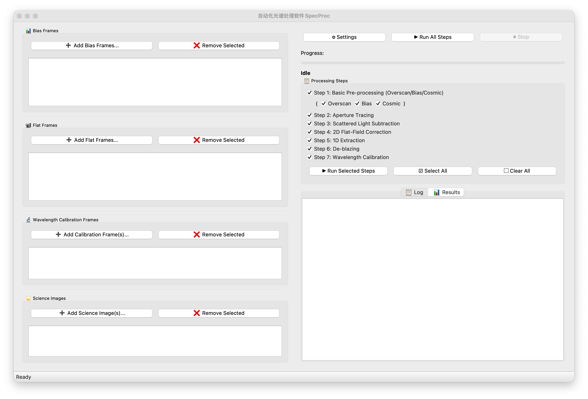

# 自动化光谱处理软件SpecProc使用手册

[English](README.md) | **简体中文**



一个功能完整、基于 PyQt 的图形化交互式管线，专门用于处理阶梯光栅与狭缝光谱仪（Echelle / Long-slit Spectrograph）的 FITS 数据。

## 目录

- [快速开始](#快速开始)
- [功能特性](#功能特性)
- [安装指南](#安装指南)
- [工作目录设置](#工作目录设置)
- [配置说明](#配置说明)
- [数据处理流程](#数据处理流程)
- [使用方法](#使用方法)
- [校准数据](#校准数据)
- [故障排除](#故障排除)
- [文档指南](#文档指南)
- [项目结构](#项目结构)
- [开源协议](#开源协议)
- [参与贡献](#参与贡献)
- [致谢](#致谢)
- [问题反馈](#问题反馈)

## 快速开始

使用 `pip install specproc` 安装后，请在源码目录之外的工作目录中运行。将本底（bias）、平场（flat）、定标灯谱和科学目标的 FITS 文件放在数据目录中。

### 命令行模式

```bash
mkdir -p ~/specproc-work
cd ~/specproc-work
specproc --profile MSTG193_slit /path/to/MSTG193_data
```

程序会分类输入文件并运行处理流程，结果和诊断图默认保存在 `output/` 目录下。其他常用命令如下：

```bash
specproc /path/to/data                   # 尝试根据 FITS 头自动识别配置
specproc                                # 处理当前目录中的 FITS 文件
specproc --profile XL216_hrs /path/to/data
specproc --config /path/to/custom.cfg /path/to/data
specproc --config MSTG193_slit           # 将内置配置复制到当前目录
```

内置望远镜和仪器配置文件位于 `src/specproc/config/`，文件名为
`default_config_<profile>.cfg`。可用配置档包括 `MSTG193_slit`（慕士塔格
1.93 米狭缝）、`XL216_hrs`（兴隆 2.16 米 HRS）、`NS12_hrs`（南山 1.2 米）
和 `LJ24_hrs`（丽江 2.4 米 HRS）。例如，慕士塔格配置文件路径为
`src/specproc/config/default_config_MSTG193_slit.cfg`。

程序可能沿用已有的工作配置，而不是覆盖为内置默认配置；请留意配置差异警告。
运行 `specproc --help` 可查看其他选项。

### 图形界面模式

```bash
specproc --mode gui
```

1. 打开 **Settings** → **Data & Instruments**，在 **Configuration File** 中选择望远镜和光谱仪配置，或点击 **Browse...** 加载配置文件；检查输出路径后点击 **Save**。
2. 使用对应按钮分别添加 bias、flat、定标灯谱和科学目标图像。
3. 点击 **Run All Steps**，查看日志，并在配置的输出目录中查看结果。

更多说明请参阅[安装指南](#安装指南)、[工作目录设置](#工作目录设置)和[使用方法](#使用方法)。

## 功能特性

### 完整的处理管线

**8 步全自动化光谱处理流程**：

1. **基础预处理 (Basic Pre-processing)** —— 过扫区(Overscan)扣除、本底(Bias)扣除与宇宙线校正。
2. **级次寻迹 (Apertures Tracing)** —— 生成主平场并追踪阶梯光栅的各个衍射级次。
3. **杂散光扣除 (Scattered Light Subtraction)** —— 级次间背景的建模与扣除（astropy 卷积或样条）。
4. **二维平场校正 (2D Flat-Field Correction)** —— 逐像素二维平场校正。
5. **一维光谱抽取 (1D Spectrum Extraction)** —— 对每个级次做最优提取。
6. **去闪耀 (De-blazing)** —— 闪耀函数改正。
7. **波长定标 (Wavelength Calibration)** —— 对最优提取并已去闪耀的一维谱做波长定标。
8. **级次拼接 (Order Stitching)** —— 把重叠的相邻级次合并为一条连续的一维光谱。

### 交互式图形界面

基于 PyQt5 的用户界面提供：

- Bias、Flat 与 Science 图像的文件管理
- 实时处理进度跟踪
- 详尽的处理日志与报错诊断
- 支持一键全自动执行，或按步骤单步执行

### 主要特性

- **配置驱动**：使用 INI 格式配置文件，参数调整直观
- **通用光谱仪支持**：可为不同的阶梯光栅/狭缝光谱仪分别配置
- **输出灵活**：可自由控制保存哪些中间结果
- **命令行接口**：除 GUI 外，也可用命令行做批处理

## 安装指南

以下任选一种方式。

### 方式一：使用 pip（推荐）

直接从 PyPI 安装。

```bash
# 安装 SpecProc
pip install specproc

# 启动程序
specproc
```

**说明：**
- 需要 Python 3.7+
- 依赖会自动从 PyPI 安装
- 属永久安装；卸载用 `pip uninstall specproc`

### 方式二：使用 conda

conda 适合希望环境隔离的用户。SpecProc 目前**没有发布到 conda-forge**，因此做法是「用 conda 建环境，再用 pip 装包」：

#### 2.1 在已有的 conda 环境中安装

```bash
# 激活你的 conda 环境
conda activate your_environment

# 用 pip 安装 SpecProc
pip install specproc

# 启动程序
specproc
```

#### 2.2 新建 conda 环境

```bash
# 为 SpecProc 新建环境
conda create -n specproc python=3.11
conda activate specproc

# 先用 conda 装好科学计算与 GUI 依赖，再用 pip 装 SpecProc
conda install -c conda-forge numpy scipy astropy matplotlib pyqt -y
pip install specproc

# 启动程序
specproc
```

**说明：**
- 推荐给希望环境隔离的用户
- 核心依赖由 conda 管理，SpecProc 本身由 pip 安装
- 支持 Python 3.7–3.11

### 方式三：从源码安装

运行安装脚本，从本地源码安装 SpecProc 及其全部依赖。

```bash
# 进入 SpecProc 源码目录
cd /path/to/SpecProc

# 赋予脚本可执行权限（如需要）
chmod +x install.sh

# 运行安装脚本
./install.sh

# 启动程序
specproc
```

**说明：**
- 安装脚本会自动处理依赖
- 会自动识别可用的包管理器（pip 或 conda）
- 会把 SpecProc 安装到系统中
- 适合从本地源码做自动化部署

## 工作目录设置

**极其重要**：`specproc` 必须在你的**观测数据工作目录**下运行，**绝不能**在 SpecProc 源码目录下运行。

### 标准工作流

```bash
# 1. 创建数据处理工作目录（例如针对某次观测）
mkdir -p /myworkspace
cd /myworkspace

# 2. 建立输入数据目录
mkdir -p 20241102_hrs

# 3. 把 FITS 文件复制进来
cp /somewhere/bias_*.fits ./20241102_hrs/
cp /somewhere/flat_*.fits ./20241102_hrs/
cp /somewhere/thar_*.fits ./20241102_hrs/
cp /somewhere/science_*.fits ./20241102_hrs/

# 4. 使用对应的望远镜配置启动管线
specproc --profile XL216_hrs ./20241102_hrs
```

### 生成的目录结构

**工作目录**（处理数据的地方）一旦运行成功，将呈现如下结构：

```text
/myworkspace/                     # 你的工作目录
├── 20241102_hrs/                 # 输入的 FITS 文件
│   ├── bias_*.fits
│   ├── flat_*.fits
│   ├── thar_*.fits               # ThAr 灯谱
│   └── science_*.fits            # 科学图像
├── output/                       # 处理结果（自动创建）
│   ├── step1_basic/              # 步骤 1：基础预处理
│   │   ├── overscan_corrected/   #   过扫区校正后的图像与诊断图
│   │   ├── bias_subtracted/      #   主本底与扣本底后的图像
│   │   ├── cosmic_corrected/     #   宇宙线校正后的科学图像（若启用）
│   │   └── cropped/              #   裁剪后的图像（若配置了 trim_*）
│   ├── step2_trace/              # 步骤 2：主平场、级次迹线与闪耀剖面、诊断图
│   ├── step3_scatterlight/       # 步骤 3：杂散光背景模型与诊断图
│   ├── step4_flat_corrected/     # 步骤 4：二维平场校正后的图像
│   ├── step5_extraction/         # 步骤 5：抽取的一维光谱（像素坐标）与诊断图
│   ├── step6_deblazing/          # 步骤 6：去闪耀后的光谱与诊断图（若保存）
│   ├── step7_wavelength/         # 步骤 7：波长定标后的光谱与诊断 PDF
│   └── step8_stitching/          # 步骤 8：拼接完成的连续一维光谱与诊断图
├── specproc.cfg                  # 你的自定义配置文件
└── ...
```

**注意**：
- ❌ 不要在 SpecProc 源码目录（`/path/to/SpecProc`）里运行 `specproc`
- ✅ 在工作目录里运行 `specproc`
- ✅ `output` 会在工作目录中自动创建

## 配置说明

你可以通过修改工作目录下的 `specproc.cfg` 来调整管线行为。

### 配置文件类型

#### 默认配置

**位置**：`SpecProc/src/specproc/config/default_config.cfg`
**作用**：提供默认参数值
**是否修改**：不建议直接修改

#### 用户配置

**位置**：工作目录下的 `specproc.cfg`
**作用**：覆盖默认配置、定制参数
**优先级**：用户配置 > 默认配置

### 路径配置

#### 数据路径

```ini
[data]
# 原始 FITS 数据目录
# 例：在工作目录 /myworkspace/ 下把 rawdata_path 设为 20241102_hrs，
# 数据将从 /myworkspace/20241102_hrs/ 读取
#
# 路径规则：
# - rawdata_path = /data/20241102_hrs  → 绝对路径，从 /data/20241102_hrs/ 读取
# - rawdata_path = ./20241102_hrs      → 相对路径，从 工作目录/20241102_hrs/ 读取
# - rawdata_path = 20241102_hrs        → 同上，同样相对于工作目录
#
# 示例（假设工作目录为 /myworkspace/）：
#   rawdata_path = ./20241102_hrs      → 数据来自 /myworkspace/20241102_hrs/
#   rawdata_path = 20241102_hrs        → 同上
#   rawdata_path = /data/20241102_hrs  → 数据来自 /data/20241102_hrs/
rawdata_path = ./20241102_hrs
```

#### 输出路径

```ini
[reduce]
# 全部处理结果的输出目录
#
# 路径规则：
# - output_path = /data/output      → 绝对路径，结果写到 /data/output/
# - output_path = ./output          → 相对路径，写到 工作目录/output/
# - output_path = output            → 同上，同样相对于工作目录
#
# 输出目录结构：
# output/
#   ├── step1_basic/            # 步骤 1：基础预处理
#   │   ├── overscan_corrected/ #   过扫区校正后的图像
#   │   ├── bias_subtracted/    #   主本底与扣本底后的图像
#   │   └── cosmic_corrected/   #   宇宙线校正后的科学图像（若启用）
#   ├── step2_trace/            # 步骤 2：主平场与闪耀剖面
#   ├── step3_scatterlight/     # 步骤 3：杂散光背景模型
#   ├── step4_flat_corrected/   # 步骤 4：二维平场校正后的图像
#   ├── step5_extraction/       # 步骤 5：抽取的一维光谱（像素坐标）
#   ├── step6_deblazing/        # 步骤 6：去闪耀后的光谱（若保存）
#   ├── step7_wavelength/       # 步骤 7：波长定标后的一维光谱
#   └── step8_stitching/        # 步骤 8：拼接完成的连续一维光谱
output_path = output
```

#### 路径示例

```bash
# 假设工作目录为 /myworkspace/
cd /myworkspace/

# 配置文件（相对路径写法）：
# [data]
# rawdata_path = ./20241102_hrs
# [reduce]
# output_path = ./output
#
# 实际使用的路径：
# 输入：/myworkspace/20241102_hrs/
# 输出：/myworkspace/output/

# 配置文件（绝对路径写法）：
# [data]
# rawdata_path = /data/20241102_hrs
# [reduce]
# output_path = /data/output
#
# 实际使用的路径：
# 输入：/data/20241102_hrs/
# 输出：/data/output/
```

### 中间结果保存

可逐个步骤控制是否保存中间结果：

```ini
[reduce.save_intermediate]
# 是否保存各步骤的中间结果
# 每一步都可独立设为 yes / no
# 默认全部为 yes
save_overscan = yes         # 步骤 1：过扫区校正（存到 output/step1_basic/overscan_corrected/）
save_bias = yes             # 步骤 1：本底校正（存到 output/step1_basic/bias_subtracted/）
save_flat = yes             # 步骤 2：平场（主平场存到 output/step2_trace/）
save_background = yes       # 步骤 3：杂散光扣除（模型存到 output/step3_scatterlight/）
save_cosmic = yes           # 步骤 1：宇宙线校正（存到 output/step1_basic/cosmic_corrected/）
save_extraction = yes       # 步骤 5：光谱抽取（存到 output/step5_extraction/）
save_deblaze = yes          # 步骤 6：去闪耀（存到 output/step6_deblazing/）
save_wlcalib = yes          # 步骤 7：波长定标（解存到 output/step7_wavelength/）
```

**效果**：
- 某一步设为 `no` 时，对应的输出子目录不会创建
- 最终光谱始终写入 `output/step8_stitching/`，不受上述开关影响
- 诊断图会保存在各步骤对应的子目录中
- GUI 中有对应的勾选项可开关这些保存行为
- 默认：所有步骤都保存中间结果

### 望远镜与校准配置

```ini
[telescope]
# 用于查找校准数据的望远镜名
name = xinglong216hrs

# 光谱仪名
instrument = hrs

[telescope.linelist]
# 灯谱线表类型
linelist_type = ThAr

# 线表目录
linelist_path = calib_data/linelists/

# 具体使用的线表文件（可选）
# 兴隆 2.16 米 HRS 推荐 thar-noao.dat
linelist_file = thar-noao.dat

# 是否使用预先证认好的校准文件（可选）
use_precomputed_calibration = yes
calibration_path = calib_data/telescopes/xinglong216hrs/

# 具体使用的校准文件（可选）
calibration_file = wlcalib_20211123011_A.fits
```

## 数据处理流程

### 各阶段说明

#### STEP 1: 基础预处理 (Basic Pre-processing)

- **输入**：原始 FITS 文件（bias、flat、ThAr、science）
- **处理**：
  - 提取过扫区（读出偏置区域）
  - 计算中值或做多项式拟合
  - 从图像中扣除过扫区偏置
  - 合并多帧 bias（均值/中值）
  - 生成 master bias
  - 从 science/flat/ThAr 图像中扣除 master bias
  - 使用 L.A.Cosmic 识别并去除宇宙线（仅科学图像）
- **输出**：预处理后的图像（过扫区、本底、宇宙线校正）
- **说明**：基础校正，为寻迹和抽取准备数据。

#### STEP 2: 级次寻迹 (Apertures Tracing)

- **输入**：预处理后的 flat 图像
- **处理**：
  - 合并 flat 图像
  - 生成 master flat
  - 识别阶梯光栅的衍射级次
  - 为每个级次拟合多项式迹线
  - 提取闪耀分布（blaze profiles）
- **输出**：主平场、级次边界（apertures）与闪耀曲线
- **说明**：为后续步骤提供级次边界与闪耀剖面。

#### STEP 3: 杂散光扣除 (Scattered Light Subtraction)

- **输入**：预处理后的科学图像
- **处理**：
  - 使用二维卷积或样条估计级次间的杂散光背景
  - 从科学图像中扣除背景模型
- **输出**：扣除背景后的图像
- **说明**：消除级次间的杂散光。

#### STEP 4: 二维平场校正 (2D Flat-Field Correction)

- **输入**：扣除背景后的科学图像
- **处理**：
  - 生成二维逐像素平场校正映射（pixel-to-pixel flat）
  - 将二维平场校正应用于科学图像
- **输出**：二维平场校正后的图像
- **说明**：纠正像素级的灵敏度差异。

#### STEP 5: 一维光谱抽取 (1D Spectrum Extraction)

- **输入**：二维平场校正后的图像
- **处理**：
  - 抽取每个级次的一维光谱
  - 方法：简单求和（Sum）或最优提取（Optimal，Horne 1986）
  - 计算抽取误差
- **输出**：SpectraSet（像素坐标）
- **说明**：把二维弯曲迹线坍缩为一维像素光谱。

#### STEP 6: 去闪耀 (De-blazing)

- **输入**：抽取出的一维光谱（像素坐标）
- **处理**：
  - 读取平场的闪耀函数（像素空间）
  - 匹配对应级次
  - 除以闪耀函数：F_corrected(λ) = F_observed(λ) / B(λ)
  - 归一化为单位连续谱
- **输出**：去闪耀后的光谱
- **说明**：校正光栅闪耀函数的包络效应，需在波长定标之后进行。

#### STEP 7: 波长定标 (Wavelength Calibration)

- **输入**：去闪耀后的一维光谱（像素坐标）
- **处理**：
  - 步骤 1：标定 ThAr 灯谱
    - 抽取一维光谱
    - 证认发射线
    - 拟合二维波长多项式：λ(x,y) = Σ p_ij·x^i·y^j
  - 步骤 2：应用到科学光谱
    - 将像素坐标转换为波长单位
- **输出**：完成波长定标的一维光谱
- **说明**：建立每个级次的物理波长标尺。

#### STEP 8: 级次拼接 (Order Stitching)

- **输入**：已定标的多级次一维光谱
- **处理**：将多个重叠的级次在重合波段按信噪比加权融合，输出一条便于后续吸收线分析的连续一维物理光谱。
- **输出**：最终的连续一维光谱
- **说明**：生成可用于科学分析的最终数据产品。

## 使用方法

### GUI 模式

```bash
# 启动 GUI（需显式指定，默认为 CLI 模式）
specproc --mode gui

# 使用自定义配置文件
specproc --mode gui --config /path/to/config.cfg
```

**操作流程**：
1. 在左侧栏分别添加对应的 Bias、Flat、Calibration（ThAr）与 Science 图像。
2. （可选）点击右上角 Settings，确认望远镜台址与参数。
3. 勾选需要执行的步骤，点 **Run All Steps** 一键到底，或点 Run Selected Steps 单步执行。
4. 实时查看进度。
5. 到 output 目录检查结果。

### 命令行模式 (CLI)

```bash
# CLI 是默认模式：处理当前目录下（按配置）的 FITS 文件
specproc

# 指定配置文件
specproc --mode cli --config /path/to/config.cfg

# 用内置的望远镜配置档名处理数据
specproc --mode cli --config XL216_hrs 20241102_hrs

# 不给输入数据时，会按原文件名把配置档复制到当前目录，
# 便于先检查/定制
specproc --config MSTG193_slit
```

**望远镜配置档（telescope profile）**：SpecProc 在 `src/specproc/config/` 下为每个支持的光谱仪附带一个 `default_config_<profile>.cfg`（例如兴隆 2.16 米 HRS 对应 `XL216_hrs`，慕士塔格 1.93 米狭缝光谱仪对应 `MSTG193_slit`）。把档名传给 `--config` 会自动解析到该内置文件，无需输入完整路径。运行 `specproc --help` 可查看可用档名列表。

未给 `--config` 时，CLI 会尝试从输入 FITS 头识别望远镜和仪器，选择匹配的内置配置档。程序会优先使用当前目录中已有的对应工作配置；如果没有，则复制内置配置并保留其文件名。也可以显式指定配置档：

```bash
specproc --profile mstg193slit raw_dir
```

如果 FITS 头里没有望远镜/仪器信息，用 `specproc --config` 生成一份可编辑的工作配置，再按观测情况调整。对 MSTG 数据，狭缝管线还会根据 `INSTRUME` 在 `mstg193slit_anchors_R.csv` 与 `mstg193slit_anchors_B.csv` 中挑对应文件（当该文件存在时）。

**南山 1.2 米光纤阶梯光栅**（`--profile nanshan12`，由 `SWOWNER = 'nanshan'` 自动识别；配置档 `NS12_hrs`）：该光谱仪有高、中、低三种分辨率模式，而 FITS 头并不区分。因此当配置 `[data] auto_resolution = yes` 时，输入帧会被自动分组，每组分别归算到 `output/<high|mid|low>/`：

- flat / 目标 / 标准星帧：按亮带的级次间距分组（横向色散剖面的自相关：高分辨率约 10–12 px，中约 16–17 px，低约 85–100 px）；
- ThAr 灯谱：把每条抽取出的级次与已定标、流量归一化的参考灯谱 `nanshan-thar-{high,mid}res.txt`（位于 `calib_data/telescopes/nanshan12/`，列为 级次、波长、归一化流量）做互相关；两者都匹配不上的按低分辨率处理；
- bias 帧：按文件名中的 `high` 标识。

步骤 1 可以裁剪图像（`trim_x_start/end`、`trim_y_start/end`，DS9 1-based，在 `flip_vertical` 之后应用；边界值 < 1 表示该侧不裁）。裁剪后的帧写入 `step1_basic/cropped/`，后续所有步骤都用它；南山配置档保留 600–1300 行。

级次寻迹会剔除伪迹（`reject_false_traces`）：越出图像、与相邻级次相交、或弯曲程度与相邻级次明显不同的迹线（`curvature_tolerance`）。`seed_columns` / `side_min_coverage` / `max_search_half` 让寻迹器能找到只在一侧可见的级次，并能跟随间距很大的弯曲级次（低分辨率模式会自动使用）。`exclude_lowest_apertures` / `exclude_highest_apertures`（`[reduce.trace]`，默认 0）跳过最低/最高的 N 条迹线，避免把纯噪声级次也抽出来（南山低分辨率模式自动设为 1）。

高/中分辨率组的初始波长解并非来自锚线表：每条抽取出的灯谱级次先与参考谱做互相关（得到级次偏移与像素位移），再用完整目录 `thar-noao.dat` 做最终拟合匹配。`nanshan-thar-lowres.txt` 列出已证认的谱线（级次、X、波长），作为锚线表使用。南山数据各衍射级次的垂直排布方向相反，因此配置里设 `[data] flip_vertical = yes`，在第 1 步中翻转。

**逐级次波长拟合**（`[reduce.wlcalib] fit_mode = per_order`）：默认（`global`）是对所有谱线拟合一个二维多项式 f(order, x)。设为 `per_order` 时仍先做二维拟合（用于剔除离群点，并为谱线数少于 `order_min_lines`、或覆盖不足探测器 60% 的级次兜底），然后对每条约束良好的级次单独用 `order_degree` 阶一维 Chebyshev 多项式重新拟合。之后再以 `refine_tolerance` 对这些级次重新匹配目录（迭代 `refine_iterations` 轮），最后做最终拟合。

**狭缝模式**（`[telescope] instrument = slit`，`MSTG193_slit` 使用）：用独立的单孔径管线（`core/slit_pipeline.py`）替代阶梯光栅各阶段：过扫区/本底 → 像素平场 → 宇宙线 → 恒星迹线 + 天光扣除 → 最优提取 → 一维波长解。帧类型由文件名判断（`frame_type_source = filename`；bias / flat / FeAr / dark，其余视为 science）。红蓝两台相机请分目录分别运行。波长定标需要 `[slit] identification_file`（像素、波长两列），或用 `wave_start`/`wave_end` 给出提示；否则光谱会以像素为横轴保存。最终一维解使用 `[slit] wave_poly_type`（默认 `legendre`，也接受 `chebyshev` 或 `polynomial`）与 `wave_poly_order`（谱线分布足够好时默认 5 阶）。

狭缝模式输出布局（编号与 HRS 一致，不需要的步骤不生成）：

- `step1_basic/{overscan_corrected,bias_subtracted,cosmic_corrected}`：每张 FITS 图都配有一份对应的 PDF 诊断图，另有 `master_bias.pdf`
- `step2_trace`：主平场、每帧灯谱与每帧科学图像的独立迹线，含逐帧 `*_trace.txt` 与 `*_trace.pdf`
- `step4_flat_corrected`：主平场/像素平场与平场校正后的图像
- `step5_extraction`：扣天光后的图像、一维光谱，以及每帧科学图像的抽取孔径/天光区诊断 PDF（沿各自迹线抽取）
- `step7_wavelength`：定标后的目标谱与灯谱 `*_wave.fits`/`*_wave.pdf`、残差图，以及两页的 `*_arc.pdf`（灯谱 + 匹配谱线/残差，以及 R(λ) 诊断）

不会生成杂散光（step3）与去闪耀（step6）目录。

**抽取孔径（狭缝模式）**：`[slit] aperture_mode = auto` 时，会用沿整条色散轴叠合的空间剖面测量每帧科学图像的空间 FWHM（对暗弱目标同样适用）；各帧 FWHM 的中值决定抽取半宽（`aperture_fwhm_factor` × FWHM，默认 1.7）与天光区起点（`sky_fwhm_factor` × FWHM，默认 3）。若无法测得 FWHM，则退回固定的 `extract_half_width` / `sky_inner_offset`；`aperture_mode = fixed` 时始终使用固定值。

**一维信噪比（狭缝模式）**：SNR 在有效光谱范围的 25/50/75% 处估计（窗口 ±`snr_half_window` px；信号取流量中值，噪声取相对二次拟合残差的标准差）。SNR 是无量纲比值，标注为 `SNR=xx@position`：波长定标前位置以像素计（`step5_extraction/*_pixel.pdf`），定标后以 Å 计（`step7_wavelength/*_wave.pdf`）。数值会标在图上，并以 `SNRPxx`/`SNRWxx` 关键字存入 `*_pixel.fits` / `*_wave.fits` 表。

**锚线（狭缝模式）**：`specproc identify` 把抽取出的灯谱发射线与参考图集（已内置 NOIRLAB/KPNO 的 FeAr 图集 `calib_data/linelists/fear.fits`）或文本线表进行证认。

- 上方上半部分显示归一化后的实测一维灯谱（横轴 pixel 标在顶部，只标记超过 SNR 阈值的峰，红色倒三角），下半部分显示参考图集/线表（蓝色，横轴波长标在底部），参考谱线按当前色散模型映射到像素坐标；
- 下方给出对已证认谱线拟合 Legendre 或 Chebyshev 级数的残差；
- 分辨本领由干净弧线的 Gaussian FWHM 估计，R = λ/FWHM，显示在单独的 R(λ) 标签页并写入保存的诊断 PDF；
- 光谱面板保持像素轴，残差面板用波长轴；两个标签页保存为 PDF 的两页；
- 基函数、阶数与残差裁剪阈值都可在窗口内调整。

点 **Auto identify** 自动匹配全部强峰，必要时手工修正（先点灯谱峰，再点对应参考线；右键删除某条线），然后保存。波长随像素递减时用 **Flip x** 翻转显示的像素轴；自动证认会根据拟合出的色散方向自动设置。保存时会写出干净的锚点 CSV——前两列（0-based 像素、波长 Å）正好就是 `[slit] identification_file` 的格式——外加一张诊断图（光谱、局部观测/参考叠合放大、残差）。之后管线会把这些锚点扩展到完整的 `full_linelist` 目录，生成最终波长解。

最终色散拟合的基函数可选：`--poly-type legendre|chebyshev|polynomial`（默认 `legendre`）与 `--poly-order`（默认 5，最高 9）；交互窗口提供相同的基函数与阶数控件。狭缝管线读取的是 `[slit] wave_poly_type` 与 `wave_poly_order`。

同一套引擎也可无界面运行（`--auto`）：

```bash
# 交互模式：参考图集 + 实测灯谱；手工调整后保存
specproc identify \
    --lamp output/step5_extraction/RR2000V_FeAr_0.8silt_0.2s_1_pixel.fits \
    --ref src/specproc/calib_data/linelists/fear.fits \
    --linelist  src/specproc/calib_data/linelists/fear.dat \
    --output    src/specproc/calib_data/telescopes/mstg193slit/mstg193slit_anchors_R.csv \
    --plot      docs/mstg193slit_R_anchor_match.pdf
# MSTG 的臂从 FITS 头读取（TELESCOP=MOST 且
# INSTRUME=Camera Spectrum-R/B）；--arm B 只是显式覆盖。

# 全自动、无窗口（参数相同；两个文件都会写出）
specproc identify --auto --lamp <lamp.fits> --ref <atlas.fits> \
    --output <ids.csv> --plot <diagnostic.pdf>
```

`identify` 接受 FITS、CSV 与 TXT 输入。残差拟合默认按内点 RMS 做 3σ 裁剪，也提供绝对 Å 裁剪模式。锚点与诊断输出默认写到当前工作目录（可用 `--output`/`--plot` 覆盖）；锚点 CSV 的列为 `pixel, wavelength, snr`。搜索会扫描色散曲率并与最强的参考线匹配，因此无需手工给点对，也无需 `wave_start`/`wave_end` 提示。两个像素方向都会尝试，所以波长随像素递减的光谱一样能匹配；窗口会翻转显示的像素轴，使波长向右递增。窗口里任何手工点对都会作为解的种子，自动匹配再在其上扩展。给 `--config` 或 `--wave-range` 只是对该范围加一个软偏好，绝不会裁剪参考目录，所以哪怕提示略有偏差，也不会被强推向错误的重号解。

典型 RR2000V 帧的立方外推到 ≈3976–11677 Å，而锚点本身覆盖 ≈5912–9784 Å；选中的锚点残差约 0.3 Å。蓝端外推已用夜天光谱校验过（[OI] 5577/6300/6363、Na I 与 Hα 都在 0.4 Å 内符合）；9800 Å 以外的红端仍是近似值。使用该文件前，务必检查两页诊断 PDF（光谱/参考匹配与残差；R(λ)），并在光栅、狭缝或相机焦点变化后重跑该工具。参考图集会与实测灯谱按同样数目的最亮峰匹配；若灯谱本身强峰太少，可降低 `--min-snr`。

**CLI 操作流程**：
1. 按提示选择文件
2. 选择处理阶段（0–7，直接回车表示全部）
3. 观察控制台进度
4. 到 output 目录检查结果

### 命令行小工具（不属于数据处理流程）

除主流程外，SpecProc 还附带几个独立小工具，统一以 `specproc.<工具名>` 独立命令调用（输入 `specproc.` 后按 Tab 可列出全部工具；`specproc <工具名>` 也可用）：

| 命令 | 用途 |
|---|---|
| `specproc.air2vac 输入 输出` | 谱线表波长由空气换算为真空（Å） |
| `specproc.vac2air 输入 输出` | 谱线表波长由真空换算为空气（Å） |
| `specproc.identify` | 灯谱证认（图形界面，或 `--auto` 全自动）：实测灯谱 + 参考图集 → 锚线 CSV + 诊断对比图 |
| `specproc tools` | 列出以上工具 |

`specproc <工具名> --help` 可查看完整参数；`specproc --help` 也会列出可用工具。若第一个参数是已存在的文件或目录，则始终按数据处理输入处理，不会被误当成工具名。

**终端自动补全**（补全工具名、工具参数及其取值；位置参数形式的文件名会退回 shell 自身的文件名补全）：

```bash
# bash：加入 ~/.bashrc
eval "$(specproc --completion bash)"

# zsh：加入 ~/.zshrc
eval "$(specproc --completion zsh)"
```

## 校准数据

### 目录结构

校准数据随包分发，位于 `src/specproc/calib_data/`：

```text
calib_data/
├── linelists/                  # 灯谱发射线表/图集
│   ├── thar-noao.dat           # ThAr 灯谱线表（兴隆 2.16 米 HRS 推荐）
│   ├── thar.dat                # 标准 ThAr 灯谱线表
│   ├── fear.dat                # FeAr 灯谱线表（Willmarth）
│   ├── fear.fits               # NOIRLAB/KPNO 的 FeAr 图集光谱（供 specproc identify 使用）
│   ├── argon.dat / xenon.dat / krypton.dat / thorium.dat
│   └── skylines.dat / ohline.dat 等辅助线表
└── telescopes/                 # 各望远镜的专用校准文件
    ├── generic/                # 通用配置模板
    ├── xinglong216hrs/         # 兴隆 2.16 米 HRS：xinglong216_thar_anchors.csv
    ├── xinglong216bfosc/       # 兴隆 2.16 米 BFOSC
    ├── lijiang24hrs/           # 丽江 2.4 米 HRS：lijiang24_hrs_thar_anchors.csv
    ├── mstg193slit/            # 慕士塔格 1.93 米狭缝：mstg193slit_anchors_{R,B}.csv
    └── nanshan12/              # 南山 1.2 米光纤：nanshan-thar-{high,mid,low}res.txt
```

### 灯谱线表

**可用线表**：
- `thar-noao.dat` —— ThAr 灯谱线表（兴隆 2.16 米 HRS 推荐）
- `thar.dat` —— 标准 ThAr 灯谱线表
- `fear.dat` —— FeAr 灯谱线表（Willmarth，3000–10,000 Å）
- `fear.fits` —— NOIRLAB/KPNO FeAr 图集光谱，供 `specproc identify` 使用

**支持的灯类型**：
- `ThAr` —— 钍氩灯（阶梯光栅光谱仪最常用）
- `FeAr` —— 铁氩灯
- `Ar` —— 氩灯
- `Ne` —— 氖灯
- `He` —— 氦灯
- `Fe` —— 铁灯

### 望远镜校准文件

各望远镜目录下存放的是**锚线表**（已证认的谱线像素-波长对照）与对应的证认说明：

| 望远镜 | 文件 |
|---|---|
| 兴隆 2.16 米 HRS | `xinglong216_thar_anchors.csv`（附 216HRS 灯谱证认文件.pdf） |
| 丽江 2.4 米 HRS | `lijiang24_hrs_thar_anchors.csv`（附 丽江2.4米灯谱定标文件.pdf） |
| 慕士塔格 1.93 米狭缝 | `mstg193slit_anchors_R.csv` / `mstg193slit_anchors_B.csv`（各附 PDF） |
| 南山 1.2 米光纤 | `nanshan-thar-highres.txt` / `-medres.txt` / `-lowres.txt`（列为 级次、波长、归一化流量） |

### 配置示例

```ini
[telescope]
name = xinglong216hrs
instrument = hrs

[telescope.linelist]
linelist_type = ThAr
linelist_path = calib_data/linelists/
linelist_file = thar-noao.dat
full_linelist = calib_data/linelists/thar-noao.dat
anchor_file = calib_data/telescopes/xinglong216hrs/xinglong216_thar_anchors.csv
```

## 故障排除

### ImportError: No module named 'PyQt5'

```bash
# 安装 PyQt5
pip install PyQt5
```

### 找不到 specproc 命令

```bash
conda activate specproc
pip install -e .
```

### 找不到配置文件

```bash
# 复制默认配置
cp /path/to/SpecProc/src/specproc/config/default_config.cfg ./specproc.cfg
```

### GitHub 大文件报错

**报错**：`File exceeds GitHub's file size limit of 100.00 MB`

**解决**：大 FITS 文件不应提交到仓库，用 `.gitignore` 排除。

**避免以后再犯**：
- 把输出目录加入 `.gitignore`
- 在独立的工作目录里运行 SpecProc，不要在源码目录里跑

## 文档指南

- 英文文档见 [README.md](README.md)
- 校准数据的配置说明见 [calib_data/README.md](src/specproc/calib_data/README.md)
- 截图与软件测评报告见 [docs/](docs/)
- 完整用户手册见 [SpecProc_User_Manual.md](SpecProc_User_Manual.md)（PDF 版：[SpecProc_User_Manual.pdf](SpecProc_User_Manual.pdf)）

## 项目结构

```text
SpecProc/
├── README.md                    # 英文主文档
├── README_CN.md                 # 中文文档（本文件）
├── pyproject.toml               # 打包与 console-script 入口定义
├── install.sh                   # 安装脚本
├── LICENSE                      # 开源协议
├── .gitignore                   # Git 忽略规则
├── docs/                        # 截图、测评报告与中文手册
├── tests/                       # pytest 测试
└── src/
    └── specproc/                # 源码
        ├── calib_data/          # 校准数据（线表、望远镜配置）
        ├── config/              # 配置管理与默认配置档
        ├── core/                # 归算管线（阶梯光栅与狭缝）
        ├── gui/                 # 主界面（主窗口、设置对话框）
        ├── plotting/            # 绘图辅助
        ├── utils/               # 通用辅助 + 独立命令行工具
        │   ├── airvac.py        #   空气 <-> 真空波长换算
        │   ├── identify.py      #   交互/自动谱线证认（`specproc identify`）
        │   ├── tool_registry.py #   `specproc tools` 背后的注册表
        │   └── completion.py    #   bash/zsh 补全支持
        └── main.py              # `specproc` 入口（GUI + CLI + 工具）
```

## 开源协议

MIT 协议，详见 [LICENSE](LICENSE)。

## 参与贡献

欢迎贡献！请随时提交 Pull Request。

## 致谢

- 灵感来自 [gamse](https://github.com/wangleon/gamse)
- 使用 PyQt5、NumPy、SciPy 与 Astropy 构建

## 问题反馈

有问题或疑问，请在 GitHub 上开 [issue](https://github.com/abiao-github/SpecProc/issues)。
